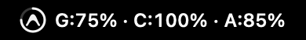
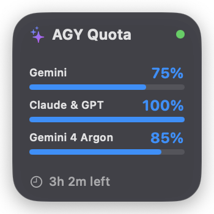

# Antigravity Quota

<p align="center">
  
</p>

<p align="center">
  <strong>A lightweight, real-time macOS menu bar quota monitor & WidgetKit widgets for Google Antigravity.</strong><br>
  <em>Track Gemini, Claude, and GPT model limits, remaining reset timers, and usage percentages directly from your status bar, desktop, and Notification Center.</em>
</p>

<p align="center">
  <a href="https://github.com/badugisoft/antigravity-quota/releases"></a>
  <a href="https://github.com/badugisoft/antigravity-quota/releases"></a>
  
  
  
  
</p>

<p align="center">
  <strong>English</strong> ·
  <a href="docs/README.ko.md">한국어</a> ·
  <a href="docs/README.zh.md">简体中文</a> ·
  <a href="docs/README.ja.md">日本語</a> ·
  <a href="docs/README.de.md">Deutsch</a> ·
  <a href="docs/README.fr.md">Français</a> ·
  <a href="docs/README.es.md">Español</a>
</p>

<p align="center">
  <a href="https://github.com/badugisoft/antigravity-quota/releases/latest"><strong>⬇️ Download Latest DMG</strong></a> ·
  <a href="https://badugisoft.github.io/antigravity-quota/"><strong>🌐 Website</strong></a> ·
  <a href="#screenshots">Screenshots</a> ·
  <a href="#features">Features</a> ·
  <a href="#installation--building">Installation</a> ·
  <a href="#faq--troubleshooting">FAQ</a> ·
  <a href="#contributing">Contributing</a>
</p>

---

## Screenshots

<p align="center">
  
  <br>
  <em>Status Bar Circular Gauge & Quota Summary</em>
</p>

<p align="center">
  
  &nbsp;&nbsp;&nbsp;&nbsp;
  
  <br>
  <em>Menu Bar Popover: Standard Mode (Left) &nbsp;|&nbsp; Compact Mode (Right)</em>
</p>

<p align="center">
  
  &nbsp;&nbsp;&nbsp;&nbsp;
  
  <br>
  <em>macOS Widgets: Small 1x1 (Left) &nbsp;|&nbsp; Medium 1x2 (Right)</em>
</p>

> [!NOTE]
> **🤖 100% Built with Google Antigravity**
>
> This entire application—including local RPC discovery, architecture, SwiftUI views, WidgetKit extensions, adaptive polling logic, multi-language localization, icon design, and build tooling—was **100% designed, implemented, and verified pair-programming autonomously with Google Antigravity**.

---

## Features

- **Real-Time Quota Monitoring**:
  - Dynamically discovers and displays all quota groups and buckets returned by Antigravity (e.g., **Gemini Models**, **Claude and GPT models**, **Gemini 4 Argon**, and future model groups).
  - Monitors both **5-Hour rolling limits** and **Weekly quota limits** across all active groups.
- **Dynamic Menu Bar Circular Gauge Icon**:
  - Renders the Antigravity emblem encircled by a live circular gauge ring reflecting the remaining quota of your selected target bucket (and switches to a dashed ring when offline).
  - Supports **Icon & Quota Percentages** (with dynamic group abbreviations such as `G:75% · C:100% · A:85%`) or **Icon Only** display modes, plus configurable gauge target selection in **Settings > General**.
- **macOS Desktop & Notification Center Widgets (WidgetKit)**:
  - **Small Widget (`systemSmall` / 1x1)**: Minimalist overview dynamically displaying all active model groups with progress bars, remaining %, online indicator, and shortest reset countdown.
  - **Medium Widget (`systemMedium` / 1x2)**: Two-column card displaying primary model groups side-by-side plus a compact bottom row for additional groups (such as Gemini 4 Argon), with countdown clocks and live status badge.
  - **Native Frosted Glass Material**: Styled with `.regularMaterial` and borderless integration (`.contentMarginsDisabled()`) to seamlessly match macOS system widgets and wallpaper tinting in both Dark and Light modes.
  - Real-time synchronization powered by `QuotaDataStore` and instant `WidgetCenter.reloadAllTimelines()` triggers whenever quota updates.
  - Fully supports macOS Dark Mode and all 7 localized languages.
- **Live Countdown Clocks**:
  - 1-second interval live countdown clocks showing exact time until the next quota replenishment (e.g., `3h 2m left`, `1d 19h left`).
  - **100% Full Quota Suppression**: When a quota is 100% full and unused, rolling window countdowns are cleanly suppressed with an `"Unused"` status rather than showing artificial rolling expiration timers.
- **Quota Refill Notifications**:
  - Pre-schedules native macOS notifications (`UNUserNotificationCenter`) to alert you as soon as a depleted 5-hour or weekly quota bucket refills to 100%.
  - Configure master toggle, separate **5-Hour** and **Weekly** alert toggles, system permission status/request controls, and **Send Test Notification** in **Settings > Notifications**.
- **Adaptive Smart Polling**:
  - **15-Second AI Burst Polling**: When AI activity (token generation, tool calling) causes quota to decrease, polling automatically accelerates to 15s for a 3-minute cooldown window to provide real-time updates while you work (even when Antigravity is in the background).
  - **60-Second Idle Polling**: When no AI quota consumption occurs, polling automatically steps down to 60s to conserve battery and CPU.
  - **Instant Focus Refresh**: Switching to the Antigravity window triggers an immediate sync to catch new changes on demand.
  - **Automatic Pause**: Polling gracefully shows paused status (`⏸`) when Antigravity is quit or offline, resuming instantly when re-launched.
- **Remote SSH Fallback (Multi-Machine Sync)**:
  - When working across multiple Macs where Antigravity is not actively running on the local machine, Antigravity Quota can seamlessly query your remote machine via SSH.
  - Fully configurable in **Settings > Remote**: enable toggle, target SSH host (supports `user@hostname` or `~/.ssh/config` aliases), configurable polling interval (30s, 1m, 2m, 5m), and built-in connection testing.
  - Executes direct one-shot remote RPC queries via `/usr/bin/ssh` with zero lingering tunnel daemons, no external dependencies, and no file synchronization overhead.
- **Compact & Standard View Modes & Preferences**:
  - **Standard Mode**: Detailed cards with visual progress gradients, percentages, and scheduled reset times.
  - **Compact Mode**: Ultra-slim, minimal view designed for zero scrolling and minimal screen real estate.
  - **Native Settings Window**: Access **General** (including **Launch at Login** via `SMAppService`), **Remote**, and **Notifications** settings directly from the gear icon in the popover header.
- **Multi-Language Support (7 Languages)**:
  - Supports **English**, **한국어 (Korean)**, **简体中文 (Simplified Chinese)**, **日本語 (Japanese)**, **Deutsch (German)**, **Français (French)**, and **Español (Spanish)**.
  - Automatically matches your macOS system language preference upon first launch.
  - 1-click dropdown menu in the popover header or language picker in Settings to switch languages on the fly.
  - All text, countdown timers, scheduled replenishment times, notifications, and timestamps are localized to the active language's locale.
- **100% Local & Private**:
  - Queries only your local `127.0.0.1` Antigravity language server (or your explicitly configured SSH host), with zero telemetry, no third-party servers, and no stored API keys. See [SECURITY.md](SECURITY.md) for details.
- **Native macOS Experience**:
  - Built with 100% Swift & SwiftUI with AppKit integration.
  - Menu-bar-only daemon (`LSUIElement = true`) with zero Dock clutter.
  - Apple Human Interface Guidelines-compliant macOS squircle icon.
  - Dynamic popover positioning ensuring clean alignment directly beneath the status bar.
  - Zero external third-party dependencies—pure Swift Package Manager.

---

## How It Works

Antigravity runs an internal language server daemon (`language_server`) listening on an ephemeral local TCP port.

1. **Process & CSRF Token Extraction**:
   Inspects `/bin/ps` to locate the active `language_server` process and extracts the session CSRF token from either CLI arguments (`--csrf_token`) or process environment variables (`ANTIGRAVITY_SERVER_CSRF_TOKEN` in Antigravity 2.34.0+ via `ps eww -p <pid>`).
2. **Instant Port Resolution**:
   Uses `/usr/sbin/lsof` (with `/usr/sbin/netstat` fallback) to find active listening TCP sockets for the detected PID in sub-milliseconds without port scanning overhead.
3. **Connect-RPC Protocol**:
   Sends HTTP/HTTPS POST requests to `127.0.0.1:<port>/exa.language_server_pb.LanguageServerService/RetrieveUserQuotaSummary` with authentication header `x-codeium-csrf-token`.
4. **Shared Data Store & Widget Sync**:
   Writes the latest quota snapshot to `~/Library/Application Support/AntigravityQuota/shared_quota.json` via `QuotaDataStore` and calls `WidgetCenter.shared.reloadAllTimelines()` so sandboxed widgets reflect fresh numbers instantly without TCC privacy prompts.
5. **Reactive Presentation**:
   Parses `remainingFraction` and `resetTime` into strongly typed Swift models and renders them seamlessly via SwiftUI, `NSStatusItem`, and WidgetKit.

---

## Adding Widgets to macOS

1. Install **Antigravity Quota.app** into `/Applications` (via DMG or `make build`).
2. Right-click on your macOS desktop and choose **Edit Widgets...** (or open **Notification Center** and click **Edit Widgets** at the bottom).
3. Search for **Antigravity Quota** in the widget gallery.
4. Choose either the **Small (1x1)** or **Medium (1x2)** widget and drag it onto your desktop or Notification Center.

---

## System Requirements

- **macOS**: 13.0 (Ventura) or higher.
- **Hardware**: Apple Silicon (M1/M2/M3/M4) or Intel Mac.
- **Antigravity**: Google Antigravity installed (locally or on a reachable SSH host).
- **Development Tool**: Xcode 15.0+ or Swift 5.9+ toolchain (only if compiling from source).

---

## Installation & Building

### 1. Download Pre-built App (DMG)

Download the latest disk image from [GitHub Releases](https://github.com/badugisoft/antigravity-quota/releases):

1. Download **`Antigravity-Quota-<version>.dmg`** and open it.
2. Drag **Antigravity Quota.app** into your **Applications** folder.
3. Launch **Antigravity Quota** directly from **Applications**—official releases are signed with an Apple **Developer ID** certificate and **notarized by Apple**.
   > *(For older historical releases `v1.3.1` and earlier, right-click the app > **Open**, or run `xattr -cr "/Applications/Antigravity Quota.app"`.)*

### 2. Build and Install via Script from Source

Run the included automated build script from the repository root:

```bash
git clone https://github.com/badugisoft/antigravity-quota.git
cd antigravity-quota
make build
```

The script will:

1. Compile all targets in `Release` mode (`swift build -c release`).
2. Package the main app (`Antigravity Quota.app`) and embed the WidgetKit extension (`Contents/PlugIns/AntigravityQuotaWidget.appex`).
3. Embed high-resolution icons (`AppIcon.icns`) and configure `Info.plist` with `LSUIElement=true`.
4. Codesign both the extension and the main application bundle (inside-out signing, using a local Developer ID certificate if available or falling back to ad-hoc signing).
5. Install it directly into `/Applications/Antigravity Quota.app`.
6. Launch the menu bar app automatically.

### 3. Manual Build with SwiftPM

```bash
swift build -c release
```

The executables will be generated at `.build/release/AntigravityQuota` and `.build/release/AntigravityQuotaWidgetExtension`.

---

## Running at Login (Optional)

You can enable **Launch at Login** directly inside the app via **Settings > General > Launch at Login**, or configure it manually in macOS:

1. Open **System Settings** on your Mac.
2. Navigate to **General** > **Login Items**.
3. Under **Open at Login**, click the **+** button.
4. Select `/Applications/Antigravity Quota.app` and click **Open**.

---

## FAQ & Troubleshooting

<details>
<summary><strong>macOS says "Antigravity Quota" cannot be opened because the developer cannot be verified</strong></summary>

Because current official releases (`v1.4.0+`) are signed with an Apple Developer ID certificate and notarized by Apple, they open without Gatekeeper warnings. If you are running a self-built ad-hoc binary or an older historical release (`v1.3.1` or earlier), **Right-click** `Antigravity Quota.app` in `/Applications`, click **Open**, and confirm **Open**, or run:

```bash
xattr -cr "/Applications/Antigravity Quota.app"
```

</details>

<details>
<summary><strong>The menu bar shows "Waiting for Antigravity" or "Offline"</strong></summary>

Antigravity Quota reads quota directly from the running Google Antigravity `language_server` process. Make sure Google Antigravity is open locally—or, if you run Antigravity on another Mac/Linux machine, enable Remote SSH under **Settings > Remote**.

</details>

<details>
<summary><strong>Why does a 100% full quota show "Unused" instead of a countdown?</strong></summary>

Antigravity's 5-hour and weekly limits operate on a rolling window over consumed quota. When 100% of a bucket is intact, the server dynamically shifts the candidate reset timestamp forward on each request (`now + 5h`), so Antigravity Quota suppresses the artificial countdown and shows `"Unused"` until consumption begins.

</details>

<details>
<summary><strong>Does it collect telemetry or require API keys?</strong></summary>

No. Antigravity Quota runs 100% locally against `127.0.0.1` (or your configured SSH host), stores zero API keys or account credentials, and sends zero telemetry or analytics. See [SECURITY.md](SECURITY.md) for the full privacy architecture.

</details>

<details>
<summary><strong>Can I monitor Antigravity running on another Mac?</strong></summary>

Yes. Configure key-based SSH authentication (`BatchMode=yes`, no password prompt) to the target machine, then open **Settings > Remote**, turn on **Enable Remote SSH Query**, enter your `user@hostname` or `~/.ssh/config` alias, and click **Test Connection**.

</details>

---

## Contributing

Contributions, bug reports, and feature requests are welcome!

- Review [CONTRIBUTING.md](CONTRIBUTING.md) for local setup, pure-Swift conventions, and multi-language guidelines.
- Report bugs or suggest enhancements using the [GitHub Issue Templates](https://github.com/badugisoft/antigravity-quota/issues/new/choose).
- Review [SECURITY.md](SECURITY.md) for privacy details and vulnerability reporting.

---

## Project Structure

```
antigravity-quota/
├── .github/
│   ├── ISSUE_TEMPLATE/
│   │   ├── bug_report.md                        # Bug report issue template
│   │   ├── feature_request.md                   # Feature request issue template
│   │   └── config.yml                           # Issue chooser & release links
│   ├── PULL_REQUEST_TEMPLATE.md                 # Pull request checklist template
│   ├── release.yml                              # Release notes category rules
│   └── workflows/
│       ├── release.yml                          # GitHub Actions CI/CD release workflow
│       └── pages.yml                            # GitHub Pages deployment workflow
├── Package.swift                                # SwiftPM multi-target configuration
├── LICENSE                                      # MIT License
├── README.md                                    # English documentation
├── CONTRIBUTING.md                              # Contributor guide & conventions
├── SECURITY.md                                  # Privacy & security policy
├── AGENTS.md                                    # Guidelines for AI agents & contributors
├── site/                                        # Promotional GitHub Pages website (7 languages)
│   ├── index.html                               # Landing page structure
│   ├── styles.css                               # Light/dark adaptive macOS styling
│   └── i18n.js                                  # 7-language translations & switcher
├── docs/                                        # Localized documentation
│   ├── README.ko.md                             # 한국어 (Korean)
│   ├── README.zh.md                             # 简体中文 (Simplified Chinese)
│   ├── README.ja.md                             # 日本語 (Japanese)
│   ├── README.de.md                             # Deutsch (German)
│   ├── README.fr.md                             # Français (French)
│   └── README.es.md                             # Español (Spanish)
├── assets/                                      # Documentation screenshots and preview assets
│   ├── menubar_summary.png                      # Status bar gauge & summary snapshot
│   ├── popover_standard.png                     # Standard mode popover
│   ├── popover_compact.png                      # Compact mode popover
│   ├── widget_small.png                         # Small 1x1 macOS widget
│   ├── widget_medium.png                        # Medium 1x2 macOS widget
│   └── app_icon.png                             # 512x512 app icon
├── Makefile                                     # Build, test, package, and release targets
├── scripts/
│   ├── build_app.sh                             # App & WidgetKit extension build script
│   ├── package_release.sh                       # Automated .dmg and .zip release packager
│   ├── generate_release_notes.sh                # CHANGELOG.md release notes extractor
│   └── entitlements/                            # macOS App Sandbox & group entitlements
│       ├── app.entitlements                     # Host app entitlements
│       └── widget.entitlements                  # Sandboxed widget extension entitlements
├── Sources/
│   ├── AntigravityQuotaCore/                    # Shared core library
│   │   ├── Models/
│   │   │   ├── QuotaModel.swift                 # Quota data models & time formatting
│   │   │   └── QuotaSnapshot.swift              # Snapshot representation for widgets
│   │   ├── Services/
│   │   │   ├── AppSettings.swift                # Persistent preferences & Launch at Login
│   │   │   ├── QuotaDataStore.swift             # Shared App Support JSON store & WidgetCenter sync
│   │   │   ├── NotificationManager.swift        # Scheduled & immediate refill notifications
│   │   │   ├── LocalizationManager.swift        # Multi-language manager & dispatcher
│   │   │   └── Localization/                    # 7 supported language dictionaries
│   │   │       ├── LocalizedStrings+EN.swift
│   │   │       ├── LocalizedStrings+KO.swift
│   │   │       ├── LocalizedStrings+ZH.swift
│   │   │       ├── LocalizedStrings+JA.swift
│   │   │       ├── LocalizedStrings+DE.swift
│   │   │       ├── LocalizedStrings+FR.swift
│   │   │       └── LocalizedStrings+ES.swift
│   │   └── Views/
│   │       ├── SmallQuotaWidgetView.swift       # Small (1x1) widget layout
│   │       ├── MediumQuotaWidgetView.swift      # Medium (1x2) widget layout
│   │       └── WidgetBackgroundModifier.swift   # Cross-version widget background
│   ├── AntigravityQuota/                        # Menu bar application
│   │   ├── main.swift                           # App entrypoint
│   │   ├── App/
│   │   │   └── AppDelegate.swift                # NSStatusItem & NSPopover lifecycle
│   │   ├── Services/
│   │   │   ├── LanguageServerDiscovery.swift    # Process PID, CSRF, & port discovery
│   │   │   ├── MenuBarIconRenderer.swift        # Dynamic circular gauge menu bar icon
│   │   │   ├── QuotaService.swift               # Connect-RPC client & SSH fallback
│   │   │   └── RemoteSSHQuotaService.swift      # Remote SSH one-shot quota query
│   │   ├── ViewModels/
│   │   │   └── QuotaViewModel.swift             # Main ViewModel & adaptive timers
│   │   ├── Views/
│   │   │   ├── MenuBarPopoverView.swift         # Popover root view & header controls
│   │   │   ├── QuotaGroupCardView.swift         # Standard mode card
│   │   │   ├── QuotaBucketRowView.swift         # Standard mode bucket row
│   │   │   ├── QuotaGroupCompactCardView.swift  # Compact mode card
│   │   │   ├── QuotaBucketCompactRowView.swift  # Compact mode bucket row
│   │   │   └── Settings/
│   │   │       ├── SettingsView.swift           # General, Remote & Notifications tabs
│   │   │       └── SettingsWindowController.swift # Settings window lifecycle
│   │   └── Resources/
│   │       └── AppIcon.icns                     # macOS Big Sur+ HIG squircle icon
│   └── AntigravityQuotaWidget/                  # WidgetKit extension bundle
│       ├── AntigravityQuotaWidgetBundle.swift   # @main WidgetBundle definition
│       └── QuotaTimelineProvider.swift          # WidgetKit TimelineProvider
└── Tests/
    └── AntigravityQuotaTests/
        ├── QuotaModelTests.swift                # Models, localization & widget rendering tests
        └── QuotaServiceIntegrationTests.swift   # Live RPC discovery integration test
```

---

## License

This project is licensed under the **MIT License** - see the [LICENSE](LICENSE) file for details.

---

<p align="center">
  Crafted with ❤️ by BadugiSoft & Google Antigravity.
</p>
