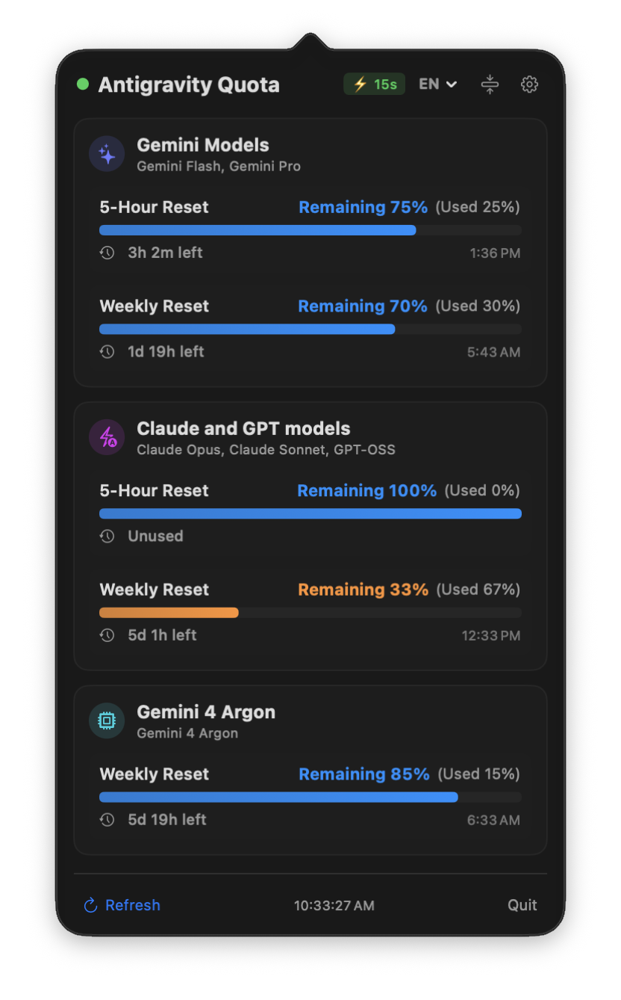

# Antigravity Quota

<p align="center">
  
</p>

<p align="center">
  <strong>Un monitor de cuotas ligero y en tiempo real en la barra de menús de macOS y widgets de WidgetKit para Google Antigravity.</strong><br>
  <em>Consulta los límites de los modelos Gemini, Claude y GPT, los temporizadores de reinicio y los porcentajes restantes directamente desde la barra de estado, el escritorio y el Centro de notificaciones.</em>
</p>

<p align="center">
  
  
  
  
  
</p>

<p align="center">
  <a href="../README.md">English</a> ·
  <a href="README.ko.md">한국어</a> ·
  <a href="README.zh.md">简体中文</a> ·
  <a href="README.ja.md">日本語</a> ·
  <a href="README.de.md">Deutsch</a> ·
  <a href="README.fr.md">Français</a> ·
  <strong>Español</strong>
</p>

---

> [!NOTE]
> **🤖 100% Built with Google Antigravity**
>
> Toda esta aplicación —incluido el descubrimiento RPC local, la arquitectura, las vistas SwiftUI, las extensiones WidgetKit, el sondeo adaptativo, la localización multilingüe, el diseño del icono y los scripts de compilación— fue **diseñada, implementada y verificada al 100 % mediante programación en pareja autónoma con Google Antigravity**.

---

## Capturas de pantalla

<p align="center">
  
  <br>
  <em>Indicador circular y resumen de cuota en la barra de estado</em>
</p>

<p align="center">
  
  &nbsp;&nbsp;&nbsp;&nbsp;
  
  <br>
  <em>Popover de la barra de menús: Modo Estándar (izquierda) &nbsp;|&nbsp; Modo Compacto (derecha)</em>
</p>

<p align="center">
  
  &nbsp;&nbsp;&nbsp;&nbsp;
  
  <br>
  <em>Widgets de macOS: Pequeño 1x1 (izquierda) &nbsp;|&nbsp; Mediano 1x2 (derecha)</em>
</p>

---

## Características

- **Monitorización de cuotas en tiempo real**:
  - Descubre y muestra dinámicamente todos los grupos y bloques de cuota devueltos por Antigravity (p. ej., **Gemini Models**, **Claude and GPT models**, **Gemini 4 Argon** y futuros grupos de modelos).
  - Supervisa tanto los **límites móviles de 5 horas** como los **límites semanales** en todos los grupos activos.
- **Icono dinámico con indicador circular en la barra de menús**:
  - Dibuja el logotipo de Antigravity rodeado de un anillo indicador circular en vivo que refleja el porcentaje restante del bloque de cuota seleccionado (y cambia a un anillo discontinuo cuando está desconectado).
  - Admite los modos **Icono y porcentajes de cuota** (con abreviaturas dinámicas por grupo como `G:75% · C:100% · A:85%`) o **Solo icono**, además de poder elegir el **Objetivo del indicador circular** en **Ajustes > General**.
- **Widgets de macOS para Escritorio y Centro de notificaciones (WidgetKit)**:
  - **Widget pequeño (`systemSmall` / 1x1)**: Resumen minimalista que muestra dinámicamente todos los grupos de modelos activos con barras de progreso, % restante, indicador de conexión y la cuenta atrás más próxima.
  - **Widget mediano (`systemMedium` / 1x2)**: Tarjeta de dos columnas con los grupos principales lado a lado más una fila inferior compacta para grupos adicionales (como Gemini 4 Argon), con cuentas atrás e indicador de estado en vivo.
  - **Material translúcido nativo**: Diseñado con `.regularMaterial` e integración sin bordes (`.contentMarginsDisabled()`) para integrarse con los widgets del sistema macOS y el fondo de pantalla en modos Oscuro y Claro.
  - Sincronización en tiempo real mediante `QuotaDataStore` y llamadas inmediatas a `WidgetCenter.reloadAllTimelines()` en cada actualización.
  - Compatibilidad total con el Modo Oscuro de macOS y los 7 idiomas localizados.
- **Cuentas atrás en directo**:
  - Temporizadores actualizados cada segundo que muestran el tiempo exacto hasta la próxima recarga (p. ej., `Quedan 3h 2min`, `Quedan 1d 19h`).
  - **Supresión de temporizador al 100 % sin usar**: Cuando una cuota está al 100 % sin consumo, las ventanas móviles muestran limpiamente `"Sin usar"` en lugar de temporizadores artificiales de expiración.
- **Notificaciones de recarga de cuota**:
  - Programa de antemano notificaciones nativas de macOS (`UNUserNotificationCenter`) para avisarte en cuanto una cuota de 5 horas o semanal agotada se recargue al 100 %.
  - Configura el interruptor general, las alertas independientes **Alerta de reinicio de cuota de 5 horas** y **Alerta de reinicio de cuota semanal**, el estado de permisos del sistema y **Enviar notificación de prueba** en **Ajustes > Notificaciones**.
- **Sondeo inteligente adaptativo**:
  - **Sondeo rápido de 15 s por actividad de IA**: Cuando la actividad de IA (generación de tokens, uso de herramientas) reduce la cuota, el sondeo se acelera automáticamente a cada 15 s durante una ventana de 3 minutos para ofrecer actualizaciones en tiempo real incluso en segundo plano.
  - **Sondeo en reposo de 60 s**: Sin consumo de cuota, el intervalo vuelve automáticamente a 60 s para ahorrar batería y CPU.
  - **Actualización inmediata al enfocar**: Al cambiar a la ventana de Antigravity se ejecuta una sincronización inmediata.
  - **Pausa automática**: Muestra el estado en pausa (`⏸`) cuando Antigravity se cierra o está desconectado y se reanuda al instante al volver a abrirlo.
- **Respaldo por SSH remoto (Sincronización entre varios equipos)**:
  - Al trabajar entre varios Mac donde Antigravity no se ejecuta localmente, Antigravity Quota puede consultar la máquina remota por SSH.
  - Totalmente configurable en **Ajustes > Remoto**: **Habilitar consulta de cuota por SSH remoto**, **Host SSH** (`user@hostname` o alias de `~/.ssh/config`), **Intervalo de sondeo remoto** (30 s, 1 min, 2 min, 5 min) y **Probar conexión**.
  - Ejecuta consultas RPC directas de un solo uso mediante `/usr/bin/ssh` sin túneles persistentes en segundo plano, dependencias externas ni sincronización de archivos.
- **Modos Estándar / Compacto y Ajustes**:
  - **Modo Estándar**: Tarjetas detalladas con barras de progreso degradadas, porcentajes restantes/usados y horas de reinicio programadas.
  - **Modo Compacto**: Vista ultradelgada sin desplazamiento para ocupar el mínimo espacio en pantalla.
  - **Ventana de Ajustes nativa**: Accede a **General** (incluido **Abrir al iniciar sesión** con `SMAppService`), **Remoto** y **Notificaciones** desde el icono de engranaje en la cabecera del popover.
- **Soporte multilingüe (7 idiomas)**:
  - Compatible con **English**, **한국어**, **简体中文**, **日本語**, **Deutsch**, **Français** y **Español**.
  - Detecta automáticamente el idioma del sistema macOS en el primer inicio.
  - Menú desplegable de un clic en la cabecera del popover o selector en Ajustes para cambiar de idioma al instante.
  - Todos los textos, cuentas atrás, horarios de reinicio, notificaciones y marcas de tiempo se adaptan a la configuración regional del idioma activo.
- **Experiencia macOS nativa**:
  - Desarrollada al 100 % en Swift, SwiftUI, AppKit y WidgetKit.
  - Aplicación exclusiva de barra de menús (`LSUIElement = true`) sin icono en el Dock.
  - Icono squircle conforme a las Apple Human Interface Guidelines.
  - Cero dependencias externas de terceros: Swift Package Manager puro.

---

## Cómo funciona

Antigravity ejecuta un demonio interno de servidor de lenguaje (`language_server`) escuchando en un puerto TCP local efímero.

1. **Extracción del proceso y token CSRF**:
   Inspecciona `/bin/ps` para localizar el proceso `language_server` activo y extrae el token CSRF de sesión desde los argumentos CLI (`--csrf_token`) o las variables de entorno (`ANTIGRAVITY_SERVER_CSRF_TOKEN` en Antigravity 2.34.0+ mediante `ps eww -p <pid>`).
2. **Resolución instantánea de puertos**:
   Utiliza `/usr/sbin/lsof` (con respaldo en `/usr/sbin/netstat`) para encontrar sockets TCP en escucha del PID detectado en menos de un milisegundo sin escaneo de puertos.
3. **Protocolo Connect-RPC**:
   Envía peticiones HTTP/HTTPS POST a `127.0.0.1:<port>/exa.language_server_pb.LanguageServerService/RetrieveUserQuotaSummary` con la cabecera de autenticación `x-codeium-csrf-token`.
4. **Almacenamiento compartido y sincronización de widgets**:
   Guarda la última instantánea mediante `QuotaDataStore` en `~/Library/Application Support/AntigravityQuota/shared_quota.json` y llama a `WidgetCenter.shared.reloadAllTimelines()` para que los widgets en sandbox muestren los datos al instante sin diálogos de privacidad TCC.
5. **Presentación reactiva**:
   Convierte `remainingFraction` y `resetTime` en modelos Swift fuertemente tipados y los renderiza mediante SwiftUI, `NSStatusItem` y WidgetKit.

---

## Añadir widgets a macOS

1. Instala **Antigravity Quota.app** en `/Applications` (mediante el DMG o `./scripts/build_app.sh`).
2. Haz clic derecho en el escritorio de macOS y selecciona **Editar widgets...** (o abre el **Centro de notificaciones** y pulsa **Editar widgets** abajo).
3. Busca **Antigravity Quota** en la galería de widgets.
4. Elige el widget **Pequeño (1x1)** o **Mediano (1x2)** y arrástralo al escritorio o al Centro de notificaciones.

---

## Requisitos del sistema

- **macOS**: 13.0 (Ventura) o superior.
- **Hardware**: Apple Silicon (M1/M2/M3/M4) o Intel Mac.
- **Antigravity**: Google Antigravity instalado (en local o en un host SSH accesible).
- **Herramientas de desarrollo**: Xcode 15.0+ o toolchain Swift 5.9+ (solo para compilar desde el código fuente).

---

## Instalación y compilación

### 1. Descargar aplicación precompilada (DMG)

Descarga la última imagen de disco desde [GitHub Releases](https://github.com/badugisoft/antigravity-quota/releases):

1. Descarga **`Antigravity-Quota-<version>.dmg`** y ábrelo.
2. Arrastra **Antigravity Quota.app** a la carpeta **Aplicaciones (Applications)**.
3. **Primer inicio (Gatekeeper)**:
   - Dado que esta compilación de código abierto se distribuye con firma ad-hoc, macOS puede mostrar un aviso de desarrollador no verificado.
   - Haz **clic derecho** en `Antigravity Quota.app` dentro de `/Applications`, pulsa **Abrir** y vuelve a confirmar con **Abrir**.
   - O ejecuta en Terminal:
     ```bash
     xattr -cr "/Applications/Antigravity Quota.app"
     ```

### 2. Compilar e instalar mediante script desde el código fuente

Ejecuta el script de compilación automatizado desde la raíz del repositorio:

```bash
git clone https://github.com/badugisoft/antigravity-quota.git
cd antigravity-quota
./scripts/build_app.sh
```

El script realizará automáticamente los siguientes pasos:

1. Compilar todos los objetivos en modo `Release` (`swift build -c release`).
2. Empaquetar la aplicación principal (`Antigravity Quota.app`) e incrustar la extensión WidgetKit (`Contents/PlugIns/AntigravityQuotaWidget.appex`).
3. Incrustar los iconos de alta resolución (`AppIcon.icns`) y configurar `Info.plist` con `LSUIElement=true`.
4. Firmar ad-hoc tanto la extensión como el paquete principal de dentro hacia fuera.
5. Instalar directamente en `/Applications/Antigravity Quota.app`.
6. Iniciar automáticamente la aplicación en la barra de menús.

### 3. Compilación manual con SwiftPM

```bash
swift build -c release
```

Los ejecutables se generarán en `.build/release/AntigravityQuota` y `.build/release/AntigravityQuotaWidgetExtension`.

---

## Abrir al iniciar sesión (Opcional)

Puedes activar **Abrir al iniciar sesión** directamente desde la app en **Ajustes > General > Abrir al iniciar sesión**, o configurarlo manualmente en macOS:

1. Abre **Ajustes del Sistema** en tu Mac.
2. Ve a **General** > **Ítems de inicio y extensiones** (o **Ítems de inicio**).
3. En **Abrir al iniciar sesión**, haz clic en el botón **+**.
4. Selecciona `/Applications/Antigravity Quota.app` y haz clic en **Abrir**.

---

## Estructura del proyecto

```
antigravity-quota/
├── .github/
│   └── workflows/
│       └── release.yml                          # Flujo CI/CD de publicación en GitHub Actions
├── Package.swift                                # Configuración multi-objetivo de SwiftPM
├── LICENSE                                      # Licencia MIT
├── README.md                                    # Documentación en inglés (raíz)
├── AGENTS.md                                    # Guía para agentes de IA y colaboradores
├── docs/                                        # Documentación multilingüe
│   ├── README.ko.md                             # 한국어
│   ├── README.zh.md                             # 简体中文
│   ├── README.ja.md                             # 日本語
│   ├── README.de.md                             # Deutsch
│   ├── README.fr.md                             # Français
│   └── README.es.md                             # Español
├── assets/                                      # Capturas e icono para documentación
│   ├── menubar_summary.png                      # Indicador y resumen de barra de estado
│   ├── popover_standard.png                     # Popover en modo estándar
│   ├── popover_compact.png                      # Popover en modo compacto
│   ├── widget_small.png                         # Widget macOS pequeño 1x1
│   ├── widget_medium.png                        # Widget macOS mediano 1x2
│   └── app_icon.png                             # Icono de la app 512x512
├── scripts/
│   ├── build_app.sh                             # Script de compilación de App y WidgetKit
│   ├── package_release.sh                       # Empaquetador automático de .dmg y .zip
│   └── entitlements/                            # Permisos de App Sandbox en macOS
│       ├── app.entitlements                     # Entitlements de la app principal
│       └── widget.entitlements                  # Entitlements de la extensión widget
├── Sources/
│   ├── AntigravityQuotaCore/                    # Biblioteca núcleo compartida
│   │   ├── Models/
│   │   │   ├── QuotaModel.swift                 # Modelos de cuota y formato de tiempo
│   │   │   └── QuotaSnapshot.swift              # Estructura de instantánea para widgets
│   │   ├── Services/
│   │   │   ├── AppSettings.swift                # Preferencias persistentes e inicio automático
│   │   │   ├── QuotaDataStore.swift             # JSON en Application Support y sync WidgetCenter
│   │   │   ├── NotificationManager.swift        # Notificaciones programadas e inmediatas
│   │   │   ├── LocalizationManager.swift        # Gestor y despachador multilingüe
│   │   │   └── Localization/                    # Diccionarios de los 7 idiomas soportados
│   │   │       ├── LocalizedStrings+EN.swift
│   │   │       ├── LocalizedStrings+KO.swift
│   │   │       ├── LocalizedStrings+ZH.swift
│   │   │       ├── LocalizedStrings+JA.swift
│   │   │       ├── LocalizedStrings+DE.swift
│   │   │       ├── LocalizedStrings+FR.swift
│   │   │       └── LocalizedStrings+ES.swift
│   │   └── Views/
│   │       ├── SmallQuotaWidgetView.swift       # Diseño del widget pequeño (1x1)
│   │       ├── MediumQuotaWidgetView.swift      # Diseño del widget mediano (1x2)
│   │       └── WidgetBackgroundModifier.swift   # Fondo del widget entre versiones
│   ├── AntigravityQuota/                        # Aplicación de barra de menús
│   │   ├── main.swift                           # Punto de entrada
│   │   ├── App/
│   │   │   └── AppDelegate.swift                # Ciclo de vida de NSStatusItem y NSPopover
│   │   ├── Services/
│   │   │   ├── LanguageServerDiscovery.swift    # Detección de PID, CSRF y puerto
│   │   │   ├── MenuBarIconRenderer.swift        # Icono dinámico con indicador circular
│   │   │   ├── QuotaService.swift               # Cliente Connect-RPC y respaldo SSH
│   │   │   └── RemoteSSHQuotaService.swift      # Consulta remota puntual por SSH
│   │   ├── ViewModels/
│   │   │   └── QuotaViewModel.swift             # ViewModel principal y temporizadores adaptativos
│   │   ├── Views/
│   │   │   ├── MenuBarPopoverView.swift         # Vista raíz del popover y controles
│   │   │   ├── QuotaGroupCardView.swift         # Tarjeta en modo estándar
│   │   │   ├── QuotaBucketRowView.swift         # Fila de bloque en modo estándar
│   │   │   ├── QuotaGroupCompactCardView.swift  # Tarjeta en modo compacto
│   │   │   ├── QuotaBucketCompactRowView.swift  # Fila de bloque en modo compacto
│   │   │   └── Settings/
│   │   │       ├── SettingsView.swift           # Pestañas General, Remoto y Notificaciones
│   │   │       └── SettingsWindowController.swift # Controlador de ventana de Ajustes
│   │   └── Resources/
│   │       └── AppIcon.icns                     # Icono squircle HIG de macOS Big Sur+
│   └── AntigravityQuotaWidget/                  # Paquete de extensión WidgetKit
│       ├── AntigravityQuotaWidgetBundle.swift   # Definición @main WidgetBundle
│       └── QuotaTimelineProvider.swift          # TimelineProvider de WidgetKit
└── Tests/
    └── AntigravityQuotaTests/
        ├── QuotaModelTests.swift                # Pruebas de modelos, idiomas y widgets
        └── QuotaServiceIntegrationTests.swift   # Prueba de integración RPC en vivo
```

---

## Licencia

Este proyecto está bajo la **Licencia MIT**; consulta el archivo [LICENSE](../LICENSE) para obtener más información.

---

<p align="center">
  Crafted with ❤️ by BadugiSoft & Google Antigravity.
</p>
