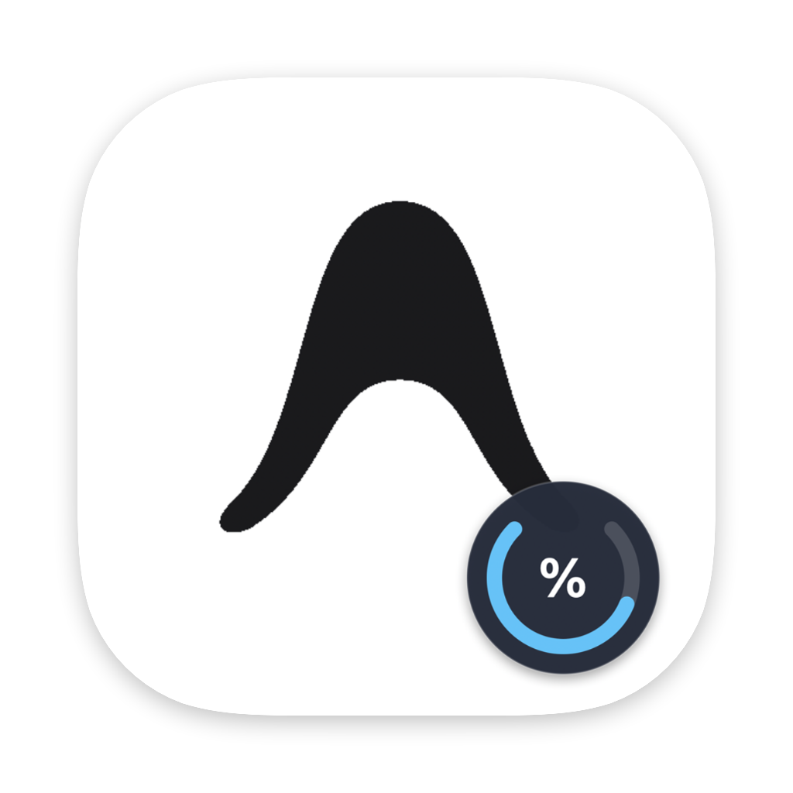
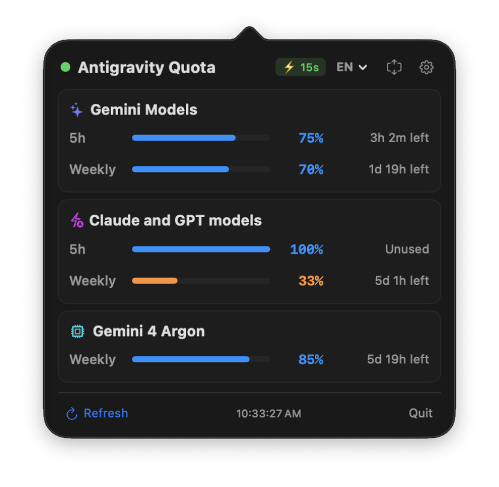

# Antigravity Quota

<p align="center">
  
</p>

<p align="center">
  <strong>Google Antigravity를 위한 가볍고 실시간으로 동작하는 macOS 메뉴바 쿼터 모니터 및 WidgetKit 위젯.</strong><br>
  <em>상태 막대, 데스크톱, 알림 센터에서 Gemini, Claude, GPT 모델의 사용량 한도, 남은 리셋 타이머, 잔여 비율을 바로 확인하세요.</em>
</p>

<p align="center">
  <a href="https://github.com/badugisoft/antigravity-quota/releases"></a>
  <a href="https://github.com/badugisoft/antigravity-quota/releases"></a>
  
  
  
  
</p>

<p align="center">
  <a href="../README.md">English</a> ·
  <strong>한국어</strong> ·
  <a href="README.zh.md">简体中文</a> ·
  <a href="README.ja.md">日本語</a> ·
  <a href="README.de.md">Deutsch</a> ·
  <a href="README.fr.md">Français</a> ·
  <a href="README.es.md">Español</a>
</p>

<p align="center">
  <a href="https://github.com/badugisoft/antigravity-quota/releases/latest"><strong>⬇️ 최신 DMG 다운로드</strong></a> ·
  <a href="https://badugisoft.github.io/antigravity-quota/?lang=ko"><strong>🌐 웹사이트</strong></a> ·
  <a href="#스크린샷">스크린샷</a> ·
  <a href="#주요-기능">주요 기능</a> ·
  <a href="#설치-및-빌드">설치</a> ·
  <a href="#자주-묻는-질문-및-문제-해결">FAQ</a> ·
  <a href="#기여하기">기여하기</a>
</p>

---

## 스크린샷

<p align="center">
  
  <br>
  <em>상태 막대 원형 게이지 및 쿼터 요약</em>
</p>

<p align="center">
  
  &nbsp;&nbsp;&nbsp;&nbsp;
  
  <br>
  <em>메뉴바 팝오버: 기본 모드 (왼쪽) &nbsp;|&nbsp; 컴팩트 모드 (오른쪽)</em>
</p>

<p align="center">
  
  &nbsp;&nbsp;&nbsp;&nbsp;
  
  <br>
  <em>macOS 위젯: 작은 크기 1x1 (왼쪽) &nbsp;|&nbsp; 중간 크기 1x2 (오른쪽)</em>
</p>

> [!NOTE]
> **🤖 100% Built with Google Antigravity**
>
> 로컬 RPC 탐색, 아키텍처 설계, SwiftUI 뷰, WidgetKit 익스텐션, 적응형 폴링 로직, 다국어 로컬라이제이션, 아이콘 디자인 및 빌드 스크립트를 포함한 전체 애플리케이션이 **Google Antigravity와의 자율 페어 프로그래밍을 통해 100% 설계, 구현 및 검증**되었습니다.

---

## 주요 기능

- **실시간 쿼터 모니터링**:
  - Antigravity가 반환하는 모든 쿼터 그룹과 버킷(예: **Gemini Models**, **Claude and GPT models**, **Gemini 4 Argon** 및 향후 추가 모델 그룹)을 동적으로 탐색하고 표시합니다.
  - 활성화된 모든 그룹의 **5시간 주기 한도**와 **일주일 주기 한도**를 모두 추적합니다.
- **동적 메뉴바 원형 게이지 아이콘**:
  - 선택한 대상 쿼터 버킷의 남은 비율을 원형 게이지 링으로 감싼 Antigravity 로고를 렌더링하며, 오프라인 상태에서는 점선 링으로 전환됩니다.
  - **아이콘 및 잔여 쿼터**(그룹별 동적 약어 표시, 예: `G:75% · C:100% · A:85%`)와 **아이콘만 표시** 모드를 지원하며, **설정 > 일반**의 **원형 게이지 표시 기준**에서 대상 버킷을 지정할 수 있습니다.
- **macOS 데스크톱 및 알림 센터 위젯 (WidgetKit)**:
  - **작은 위젯 (`systemSmall` / 1x1)**: 활성 모델 그룹 전체의 진행 막대, 잔여 %, 온라인 상태 점, 가장 가까운 리셋 카운트다운을 간결하게 표시합니다.
  - **중간 위젯 (`systemMedium` / 1x2)**: 기본 모델 그룹 두 개를 나란히 2열로 표시하고 추가 그룹(예: Gemini 4 Argon)을 하단 컴팩트 행에 배치해 카운트다운과 상태를 함께 보여줍니다.
  - **네이티브 반투명 머티리얼**: `.regularMaterial`과 여백 없는 레이아웃(`.contentMarginsDisabled()`)을 적용해 다크/라이트 모드 모두에서 macOS 시스템 위젯 및 배경화면 색조와 자연스럽게 어우러집니다.
  - `QuotaDataStore`와 즉시 실행되는 `WidgetCenter.reloadAllTimelines()` 호출로 쿼터 변경 시 위젯이 실시간 동기화됩니다.
  - macOS 다크 모드 및 7개 지원 언어를 모두 지원합니다.
- **실시간 카운트다운 타이머**:
  - 다음 쿼터 충전까지 남은 시간을 1초 단위로 갱신해 표시합니다(예: `3시간 2분 남음`, `1일 19시간 남음`).
  - **100% 완충(미사용) 타이머 억제**: 쿼터가 100% 남아 미사용 상태일 때는 인위적인 롤링 만료 타이머 대신 `"미사용"` 상태를 깔끔하게 표시합니다.
- **쿼터 충전 알림**:
  - 소모된 5시간 또는 일주일 쿼터 버킷이 100%로 충전되는 시점에 맞춰 네이티브 macOS 알림(`UNUserNotificationCenter`)을 사전 예약합니다.
  - **설정 > 알림**에서 전체 알림 토글, **5시간 쿼터 충전 알림** 및 **일주일 쿼터 충전 알림** 개별 설정, 시스템 알림 권한 확인/요청, **테스트 알림 보내기**를 이용할 수 있습니다.
- **적응형 스마트 폴링**:
  - **15초 AI 집중 폴링**: 토큰 생성이나 도구 호출 등 AI 활동으로 쿼터 소모가 감지되면 3분 쿨다운 동안 폴링 주기를 15초로 자동 가속해 백그라운드 작업 중에도 실시간 업데이트를 제공합니다.
  - **60초 유휴 폴링**: AI 쿼터 소모가 없으면 배터리와 CPU 절약을 위해 자동으로 60초 주기로 전환됩니다.
  - **창 전환 시 즉시 새로고침**: Antigravity 창으로 전환하면 즉시 1회 동기화를 수행해 최신 변화를 바로 반영합니다.
  - **자동 일시정지**: Antigravity가 종료되거나 오프라인 상태가 되면 일시정지 상태(`⏸`)로 전환되고, 다시 실행되면 즉시 재개됩니다.
- **원격 SSH 조회 폴백 (다중 머신 동기화)**:
  - 여러 대의 Mac을 사용하는 환경에서 로컬 머신에 Antigravity가 실행 중이지 않을 때 SSH를 통해 원격 머신의 쿼터를 조회할 수 있습니다.
  - **설정 > 원격**에서 **원격 SSH 쿼터 조회 사용**, **SSH 호스트**(`user@hostname` 또는 `~/.ssh/config` 별칭), **원격 조회 주기**(30초, 1분, 2분, 5분), **연결 테스트**를 간편하게 설정할 수 있습니다.
  - 백그라운드 터널 데몬이나 외부 의존성 없이 `/usr/bin/ssh`를 통한 단일 원격 RPC 쿼리로 동작합니다.
- **기본/컴팩트 모드 및 설정 창**:
  - **기본 모드**: 진행률 그라데이션 막대, 잔여/사용 비율, 예정 리셋 시각이 포함된 상세 카드 뷰.
  - **컴팩트 모드**: 스크롤 없이 화면 공간을 최소화해 한눈에 확인하는 초슬림 레이아웃.
  - **네이티브 설정 창**: 팝오버 상단의 톱니바퀴 아이콘을 통해 **일반**(`SMAppService` 기반 **로그인 시 자동 실행** 포함), **원격**, **알림** 탭에 바로 접근할 수 있습니다.
- **다국어 지원 (7개 언어)**:
  - **English**, **한국어**, **简体中文**, **日本語**, **Deutsch**, **Français**, **Español**을 지원합니다.
  - 첫 실행 시 macOS 시스템 언어 설정에 맞춰 자동 선택됩니다.
  - 팝오버 헤더 드롭다운 또는 설정의 언어 선택기에서 원클릭으로 언어를 전환할 수 있습니다.
  - 모든 UI 텍스트, 카운트다운, 예정 리셋 시각, 알림, 최종 업데이트 시각이 선택한 언어의 로케일에 맞춰 표시됩니다.
- **100% 로컬 동작 및 프라이버시 보호**:
  - 로컬 `127.0.0.1` Antigravity 언어 서버(또는 사용자가 직접 설정한 SSH 호스트)만 조회하며, 원격 분석(텔레메트리), 외부 서버 전송, API 키 저장이 전혀 없습니다. 자세한 내용은 [SECURITY.md](../SECURITY.md)를 참고하세요.
- **네이티브 macOS 환경**:
  - 100% Swift, SwiftUI, AppKit, WidgetKit으로 구축되었습니다.
  - Dock 아이콘 없이 메뉴바에서만 동작하는 데몬(`LSUIElement = true`)입니다.
  - Apple Human Interface Guidelines(HIG)를 준수하는 macOS 스쿼클(squircle) 앱 아이콘을 사용합니다.
  - 외부 서드파티 라이브러리 의존성이 전혀 없는 순수 Swift Package Manager 프로젝트입니다.

---

## 동작 원리

Antigravity는 임시 로컬 TCP 포트에서 대기하는 내부 언어 서버 데몬(`language_server`)을 실행합니다.

1. **프로세스 및 CSRF 토큰 추출**:
   `/bin/ps`를 조회해 실행 중인 `language_server` 프로세스를 찾고, CLI 인자(`--csrf_token`) 또는 프로세스 환경 변수(Antigravity 2.34.0 이상에서 `ps eww -p <pid>`로 확인되는 `ANTIGRAVITY_SERVER_CSRF_TOKEN`)에서 세션 CSRF 토큰을 추출합니다.
2. **즉시 포트 탐색**:
   포트 스캐닝 오버헤드 없이 `/usr/sbin/lsof`(`/usr/sbin/netstat` 폴백 포함)를 사용해 해당 PID의 리스닝 TCP 소켓을 밀리초 미만으로 찾아냅니다.
3. **Connect-RPC 프로토콜**:
   인증 헤더 `x-codeium-csrf-token`과 함께 `127.0.0.1:<port>/exa.language_server_pb.LanguageServerService/RetrieveUserQuotaSummary`로 HTTP/HTTPS POST 요청을 전송합니다.
4. **공유 데이터 저장소 및 위젯 동기화**:
   `QuotaDataStore`를 통해 최신 쿼터 스냅샷을 `~/Library/Application Support/AntigravityQuota/shared_quota.json`에 저장하고 `WidgetCenter.shared.reloadAllTimelines()`를 호출해 TCC 권한 팝업 없이 샌드박스 위젯을 즉시 갱신합니다.
5. **반응형 UI 렌더링**:
   `remainingFraction`과 `resetTime`을 타입 안전한 Swift 모델로 파싱해 SwiftUI, `NSStatusItem`, WidgetKit으로 매끄럽게 렌더링합니다.

---

## macOS 위젯 추가 방법

1. DMG 또는 `./scripts/build_app.sh`를 이용해 **Antigravity Quota.app**을 `/Applications`에 설치합니다.
2. macOS 데스크톱에서 우클릭 후 **위젯 편집...**을 선택합니다(또는 **알림 센터** 하단의 **위젯 편집** 클릭).
3. 위젯 갤러리에서 **Antigravity Quota**를 검색합니다.
4. **작은 크기(1x1)** 또는 **중간 크기(1x2)** 위젯을 선택해 데스크톱이나 알림 센터로 드래그합니다.

---

## 시스템 요구 사항

- **macOS**: 13.0 (Ventura) 이상.
- **하드웨어**: Apple Silicon (M1/M2/M3/M4) 또는 Intel Mac.
- **Antigravity**: Google Antigravity 설치 필요 (로컬 또는 접근 가능한 원격 SSH 호스트).
- **개발 도구**: 소스에서 직접 빌드하는 경우에만 Xcode 15.0+ 또는 Swift 5.9+ 툴체인 필요.

---

## 설치 및 빌드

### 1. 사전 빌드된 앱 다운로드 (DMG)

[GitHub Releases](https://github.com/badugisoft/antigravity-quota/releases)에서 최신 디스크 이미지를 다운로드하세요:

1. **`Antigravity-Quota-<version>.dmg`** 파일을 내려받아 엽니다.
2. **Antigravity Quota.app**을 **Applications(응용 프로그램)** 폴더로 드래그합니다.
3. **Applications(응용 프로그램)**에서 **Antigravity Quota**를 바로 실행합니다(공식 릴리즈는 Apple **Developer ID** 서명 및 **Apple 공증**이 완료되어 Gatekeeper 경고 없이 실행됩니다).
   > *(구버전 `v1.3.1` 이하를 사용하는 경우 앱 우클릭 > **열기** 또는 `xattr -cr "/Applications/Antigravity Quota.app"` 실행)*

### 2. 스크립트로 소스 빌드 및 설치

저장소 루트에서 자동 빌드 스크립트를 실행합니다:

```bash
git clone https://github.com/badugisoft/antigravity-quota.git
cd antigravity-quota
./scripts/build_app.sh
```

이 스크립트는 다음 작업을 자동으로 수행합니다:

1. 모든 타겟을 `Release` 모드로 컴파일(`swift build -c release`).
2. 메인 앱(`Antigravity Quota.app`)을 패키징하고 WidgetKit 익스텐션(`Contents/PlugIns/AntigravityQuotaWidget.appex`)을 번들에 포함.
3. 고해상도 아이콘(`AppIcon.icns`) 삽입 및 `LSUIElement=true`가 설정된 `Info.plist` 구성.
4. 익스텐션과 메인 앱 번들에 Inside-Out 방식의 코드 서명 적용 (로컬 Developer ID 인증서가 있으면 자동 사용하고, 없으면 ad-hoc 서명으로 폴백).
5. `/Applications/Antigravity Quota.app`으로 설치.
6. 메뉴바 앱 자동 실행.

### 3. SwiftPM 수동 빌드

```bash
swift build -c release
```

빌드된 실행 파일은 `.build/release/AntigravityQuota` 및 `.build/release/AntigravityQuotaWidgetExtension`에 생성됩니다.

---

## 로그인 시 자동 실행 (선택 사항)

앱 내부 **설정 > 일반 > 로그인 시 자동 실행**에서 바로 켜거나, macOS 시스템 설정에서 직접 등록할 수 있습니다:

1. Mac에서 **시스템 설정**을 엽니다.
2. **일반** > **로그인 항목 및 확장 프로그램**(또는 **로그인 항목**)으로 이동합니다.
3. **로그인 시 열기** 아래의 **+** 버튼을 클릭합니다.
4. `/Applications/Antigravity Quota.app`을 선택하고 **열기**를 클릭합니다.

---

## 자주 묻는 질문 및 문제 해결

<details>
<summary><strong>macOS에서 "확인되지 않은 개발자" 경고가 뜨며 열리지 않습니다</strong></summary>

최신 공식 릴리즈(`v1.4.0+`)는 Apple Developer ID 인증서로 서명되고 Apple 공증을 받아 Gatekeeper 경고 없이 바로 실행됩니다. 직접 빌드한 ad-hoc 바이너리나 구버전(`v1.3.1` 이하)을 실행하는 경우 `/Applications`에서 `Antigravity Quota.app`을 **우클릭 > 열기** 후 **열기**를 클릭하거나, 터미널에서 아래 명령어를 실행하세요:

```bash
xattr -cr "/Applications/Antigravity Quota.app"
```

</details>

<details>
<summary><strong>메뉴바에 "Antigravity 연결 대기 중" 또는 "오프라인"으로 표시됩니다</strong></summary>

Antigravity Quota는 실행 중인 Google Antigravity `language_server` 프로세스에서 직접 쿼터를 조회합니다. 로컬에서 Google Antigravity가 실행 중인지 확인하거나, 다른 Mac/Linux 머신에서 실행 중이라면 **설정 > 원격**에서 원격 SSH 조회를 활성화하세요.

</details>

<details>
<summary><strong>100% 남은 쿼터에 카운트다운 대신 "미사용"이라고 표시되는 이유는 무엇인가요?</strong></summary>

Antigravity의 5시간 및 일주일 한도는 사용된 쿼터에 대한 롤링 윈도우 방식으로 동작합니다. 잔량이 100% 그대로일 때는 서버가 매 요청마다 리셋 예정 시각을 현재 기준 5시간 뒤로 밀어 계산하므로, 인위적인 카운트다운 대신 실제 사용이 시작될 때까지 `"미사용"`으로 표시합니다.

</details>

<details>
<summary><strong>텔레메트리를 수집하거나 별도 API 키가 필요한가요?</strong></summary>

아니요. Antigravity Quota는 로컬 `127.0.0.1`(또는 사용자가 지정한 SSH 호스트)만 100% 로컬로 조회하며, API 키나 계정 자격 증명을 저장하지 않고 텔레메트리나 분석 데이터를 전혀 전송하지 않습니다. 자세한 내용은 [SECURITY.md](../SECURITY.md)를 확인하세요.

</details>

<details>
<summary><strong>다른 Mac에서 실행 중인 Antigravity 쿼터도 모니터링할 수 있나요?</strong></summary>

네. 대상 머신에 비밀번호 없이 접속 가능한 SSH 키 인증(`BatchMode=yes`)을 구성한 뒤, **설정 > 원격**에서 **원격 SSH 쿼터 조회 사용**을 켜고 `user@hostname` 또는 `~/.ssh/config` 별칭을 입력해 **연결 테스트**를 실행하면 됩니다.

</details>

---

## 기여하기

버그 제보, 기능 제안 및 코드 기여를 환영합니다!

- 로컬 개발 환경 설정, 순수 Swift 규칙, 다국어 가이드는 [CONTRIBUTING.md](../CONTRIBUTING.md)를 참고하세요.
- 버그 신고나 기능 요청은 [GitHub 이슈 템플릿](https://github.com/badugisoft/antigravity-quota/issues/new/choose)을 이용해 주세요.
- 보안 및 프라이버시 관련 문의는 [SECURITY.md](../SECURITY.md)를 확인해 주세요.

---

## 프로젝트 구조

```
antigravity-quota/
├── .github/
│   ├── ISSUE_TEMPLATE/
│   │   ├── bug_report.md                        # 버그 리포트 이슈 템플릿
│   │   ├── feature_request.md                   # 기능 제안 이슈 템플릿
│   │   └── config.yml                           # 이슈 선택기 및 릴리스 링크
│   ├── PULL_REQUEST_TEMPLATE.md                 # Pull Request 체크리스트 템플릿
│   ├── release.yml                              # 릴리스 노트 카테고리 규칙
│   └── workflows/
│       ├── release.yml                          # GitHub Actions CI/CD 릴리스 워크플로우
│       └── pages.yml                            # GitHub Pages 자동 배포 워크플로우
├── Package.swift                                # SwiftPM 멀티 타겟 구성
├── LICENSE                                      # MIT 라이선스
├── README.md                                    # 영문 문서 (루트)
├── CONTRIBUTING.md                              # 기여 가이드 및 프로젝트 규칙
├── SECURITY.md                                  # 프라이버시 및 보안 정책
├── AGENTS.md                                    # AI 에이전트 및 기여자 가이드라인
├── site/                                        # GitHub Pages 홍보 웹사이트 (7개 국어)
│   ├── index.html                               # 랜딩 페이지 구조
│   ├── styles.css                               # 라이트/다크 적응형 macOS 스타일
│   └── i18n.js                                  # 7개 국어 번역 및 전환 스크립트
├── docs/                                        # 다국어 문서
│   ├── README.ko.md                             # 한국어
│   ├── README.zh.md                             # 简体中文
│   ├── README.ja.md                             # 日本語
│   ├── README.de.md                             # Deutsch
│   ├── README.fr.md                             # Français
│   └── README.es.md                             # Español
├── assets/                                      # 문서용 스크린샷 및 아이콘 에셋
│   ├── menubar_summary.png                      # 상태 막대 게이지 및 요약
│   ├── popover_standard.png                     # 기본 모드 팝오버
│   ├── popover_compact.png                      # 컴팩트 모드 팝오버
│   ├── widget_small.png                         # 작은 1x1 macOS 위젯
│   ├── widget_medium.png                        # 중간 1x2 macOS 위젯
│   └── app_icon.png                             # 512x512 앱 아이콘
├── scripts/
│   ├── build_app.sh                             # 앱 및 WidgetKit 익스텐션 빌드 스크립트
│   ├── package_release.sh                       # 자동 .dmg 및 .zip 릴리스 패키징 스크립트
│   └── entitlements/                            # macOS 앱 샌드박스 및 권한 설정
│       ├── app.entitlements                     # 호스트 앱 entitlements
│       └── widget.entitlements                  # 샌드박스 위젯 익스텐션 entitlements
├── Sources/
│   ├── AntigravityQuotaCore/                    # 공용 코어 라이브러리
│   │   ├── Models/
│   │   │   ├── QuotaModel.swift                 # 쿼터 데이터 모델 및 시간 포맷팅
│   │   │   └── QuotaSnapshot.swift              # 위젯 공유용 스냅샷 구조체
│   │   ├── Services/
│   │   │   ├── AppSettings.swift                # 영구 설정 및 로그인 시 자동 실행
│   │   │   ├── QuotaDataStore.swift             # Application Support JSON 저장 및 WidgetCenter 동기화
│   │   │   ├── NotificationManager.swift        # 예약 및 즉시 쿼터 충전 알림
│   │   │   ├── LocalizationManager.swift        # 다국어 매니저 및 디스패처
│   │   │   └── Localization/                    # 7개 지원 언어 사전
│   │   │       ├── LocalizedStrings+EN.swift
│   │   │       ├── LocalizedStrings+KO.swift
│   │   │       ├── LocalizedStrings+ZH.swift
│   │   │       ├── LocalizedStrings+JA.swift
│   │   │       ├── LocalizedStrings+DE.swift
│   │   │       ├── LocalizedStrings+FR.swift
│   │   │       └── LocalizedStrings+ES.swift
│   │   └── Views/
│   │       ├── SmallQuotaWidgetView.swift       # 작은 (1x1) 위젯 레이아웃
│   │       ├── MediumQuotaWidgetView.swift      # 중간 (1x2) 위젯 레이아웃
│   │       └── WidgetBackgroundModifier.swift   # 버전 호환 위젯 배경 모디파이어
│   ├── AntigravityQuota/                        # 메뉴바 애플리케이션
│   │   ├── main.swift                           # 앱 진입점
│   │   ├── App/
│   │   │   └── AppDelegate.swift                # NSStatusItem 및 NSPopover 라이프사이클
│   │   ├── Services/
│   │   │   ├── LanguageServerDiscovery.swift    # 프로세스 PID, CSRF 및 포트 탐색
│   │   │   ├── MenuBarIconRenderer.swift        # 동적 원형 게이지 메뉴바 아이콘
│   │   │   ├── QuotaService.swift               # Connect-RPC 클라이언트 및 SSH 폴백
│   │   │   └── RemoteSSHQuotaService.swift      # 원격 SSH 단발성 쿼터 조회
│   │   ├── ViewModels/
│   │   │   └── QuotaViewModel.swift             # 메인 ViewModel 및 적응형 타이머
│   │   ├── Views/
│   │   │   ├── MenuBarPopoverView.swift         # 팝오버 루트 뷰 및 헤더 컨트롤
│   │   │   ├── QuotaGroupCardView.swift         # 기본 모드 카드
│   │   │   ├── QuotaBucketRowView.swift         # 기본 모드 버킷 행
│   │   │   ├── QuotaGroupCompactCardView.swift  # 컴팩트 모드 카드
│   │   │   ├── QuotaBucketCompactRowView.swift  # 컴팩트 모드 버킷 행
│   │   │   └── Settings/
│   │   │       ├── SettingsView.swift           # 일반, 원격 및 알림 설정 탭
│   │   │       └── SettingsWindowController.swift # 설정 창 컨트롤러
│   │   └── Resources/
│   │       └── AppIcon.icns                     # macOS Big Sur+ HIG 스쿼클 아이콘
│   └── AntigravityQuotaWidget/                  # WidgetKit 익스텐션 번들
│       ├── AntigravityQuotaWidgetBundle.swift   # @main WidgetBundle 정의
│       └── QuotaTimelineProvider.swift          # WidgetKit TimelineProvider
└── Tests/
    └── AntigravityQuotaTests/
        ├── QuotaModelTests.swift                # 모델, 다국어 및 위젯 렌더링 테스트
        └── QuotaServiceIntegrationTests.swift   # 실시간 RPC 탐색 통합 테스트
```

---

## 라이선스

이 프로젝트는 **MIT 라이선스**에 따라 배포됩니다. 자세한 내용은 [LICENSE](../LICENSE) 파일을 참고하세요.

---

<p align="center">
  Crafted with ❤️ by BadugiSoft & Google Antigravity.
</p>
