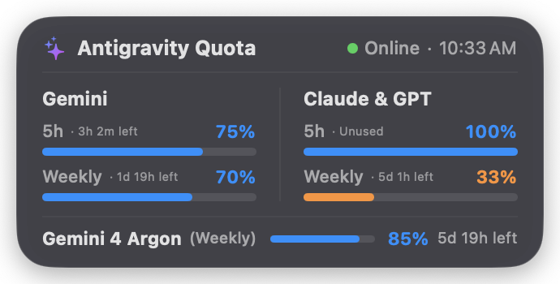

# Antigravity Quota

<p align="center">
  
</p>

<p align="center">
  <strong>专为 Google Antigravity 打造的轻量级实时 macOS 菜单栏配额监控器与 WidgetKit 小组件。</strong><br>
  <em>在状态栏、桌面和通知中心直接追踪 Gemini、Claude 和 GPT 模型额度、重置倒计时与剩余百分比。</em>
</p>

<p align="center">
  <a href="https://github.com/badugisoft/antigravity-quota/releases"></a>
  <a href="https://github.com/badugisoft/antigravity-quota/releases"></a>
  
  
  
  
</p>

<p align="center">
  <a href="../README.md">English</a> ·
  <a href="README.ko.md">한국어</a> ·
  <strong>简体中文</strong> ·
  <a href="README.ja.md">日本語</a> ·
  <a href="README.de.md">Deutsch</a> ·
  <a href="README.fr.md">Français</a> ·
  <a href="README.es.md">Español</a>
</p>

<p align="center">
  <a href="https://github.com/badugisoft/antigravity-quota/releases/latest"><strong>⬇️ 下载最新 DMG</strong></a> ·
  <a href="#界面截图">界面截图</a> ·
  <a href="#主要功能">主要功能</a> ·
  <a href="#安装与构建">安装</a> ·
  <a href="#常见问题与故障排查">常见问题</a> ·
  <a href="#参与贡献">参与贡献</a>
</p>

---

## 界面截图

<p align="center">
  
  <br>
  <em>状态栏圆环刻度与配额摘要</em>
</p>

<p align="center">
  
  &nbsp;&nbsp;&nbsp;&nbsp;
  
  <br>
  <em>菜单栏弹出窗口：标准模式（左）&nbsp;|&nbsp; 紧凑模式（右）</em>
</p>

<p align="center">
  
  &nbsp;&nbsp;&nbsp;&nbsp;
  
  <br>
  <em>macOS 小组件：小号 1x1（左）&nbsp;|&nbsp; 中号 1x2（右）</em>
</p>

> [!NOTE]
> **🤖 100% Built with Google Antigravity**
>
> 本应用的全部内容——包括本地 RPC 发现、架构设计、SwiftUI 视图、WidgetKit 扩展、自适应轮询逻辑、多语言本地化、图标设计及构建脚本——均**通过与 Google Antigravity 自主结对编程 100% 设计、实现并验证**。

---

## 主要功能

- **实时配额监控**：
  - 动态发现并展示 Antigravity 返回的所有配额分组与配额桶（例如 **Gemini Models**、**Claude and GPT models**、**Gemini 4 Argon** 以及未来新增的模型组）。
  - 同时监控所有活跃分组的 **5小时滚动限额** 与 **每周限额**。
- **动态菜单栏圆环刻度图标**：
  - 在 Antigravity 图标外围渲染实时圆环进度条，反映所选目标配额桶的剩余比例（离线时切换为虚线圆环）。
  - 支持 **图标与配额百分比**（动态生成分组缩写，如 `G:75% · C:100% · A:85%`）和 **仅图标** 显示模式，并可在 **设置 > 通用** 中自选 **圆环刻度显示目标**。
- **macOS 桌面与通知中心小组件 (WidgetKit)**：
  - **小号小组件 (`systemSmall` / 1x1)**：简洁概览，动态呈现所有活跃模型分组的进度条、剩余百分比、在线状态点及最近一次重置倒计时。
  - **中号小组件 (`systemMedium` / 1x2)**：双栏并排展示主要模型组，并在底部紧凑行显示额外分组（如 Gemini 4 Argon），同时提供倒计时与实时在线状态。
  - **原生磨砂玻璃材质**：采用 `.regularMaterial` 与无边距集成（`.contentMarginsDisabled()`），在深色和浅色模式下均能与 macOS 系统小组件及壁纸着色自然融合。
  - 每次配额更新时通过 `QuotaDataStore` 写入数据并即时触发 `WidgetCenter.reloadAllTimelines()` 完成实时同步。
  - 完整支持 macOS 深色模式和全部 7 种本地化语言。
- **实时倒计时**：
  - 每秒更新一次，精确显示距离下次配额恢复的剩余时间（例如 `剩余 3小时 2分`、`剩余 1天 19小时`）。
  - **100% 满额抑制显示**：当配额为 100% 且未使用时，优雅隐藏滚动窗口的虚拟到期计时器，改为显示 `"未使用"` 状态。
- **配额补充通知**：
  - 在已消耗的 5小时或每周配额桶恢复至 100% 时，通过原生 macOS 通知（`UNUserNotificationCenter`）提前预约发送提醒。
  - 可在 **设置 > 通知** 中配置主开关、独立的 **5小时配额重置提醒** 与 **每周配额重置提醒**、查看或请求系统通知权限以及点击 **发送测试通知**。
- **自适应智能轮询**：
  - **15 秒 AI 高频轮询**：当 AI 活动（生成文本或工具调用）引起配额下降时，轮询间隔自动加速至 15 秒并维持 3 分钟冷却窗口，在后台运行时也能实时反馈最新消耗。
  - **60 秒空闲轮询**：未发生配额消耗时自动降回 60 秒间隔，节省电量与 CPU 资源。
  - **切换焦点即时刷新**：切换到 Antigravity 窗口时立即触发一次同步，第一时间捕获变更。
  - **自动暂停**：当 Antigravity 退出或离线时自动切换为暂停状态（`⏸`），重新启动后即刻恢复。
- **远程 SSH 回退（多机同步）**：
  - 在多台 Mac 之间协作且本地未运行 Antigravity 时，可通过 SSH 直接查询远程机器上的配额。
  - 在 **设置 > 远程** 中即可启用：**启用远程 SSH 配额查询**、填写 **SSH 主机**（支持 `user@hostname` 或 `~/.ssh/config` 别名）、设置 **远程轮询间隔**（30 秒、1 分钟、2 分钟、5 分钟）并执行 **测试连接**。
  - 通过 `/usr/bin/ssh` 执行一次性直连 RPC 查询，无常驻隧道后台进程、无额外依赖，也无需文件同步。
- **标准 / 紧凑视图与偏好设置**：
  - **标准模式**：带有渐变进度条、剩余/已用百分比及预计重置时间的完整卡片视图。
  - **紧凑模式**：超纤薄精简布局，无需滚动即可节省桌面与屏幕空间。
  - **原生设置窗口**：点击弹窗顶部齿轮图标即可打开包含 **通用**（含基于 `SMAppService` 的 **开机自动启动**）、**远程** 和 **通知** 的设置窗口。
- **多语言支持（7 种语言）**：
  - 支持 **English**、**한국어**、**简体中文**、**日本語**、**Deutsch**、**Français** 和 **Español**。
  - 首次启动时自动匹配 macOS 系统语言设置。
  - 可在弹窗顶部下拉菜单或设置窗口中一键实时切换语言。
  - 所有界面文本、倒计时、重置时间、通知内容和更新时间均依据当前语言本地化显示。
- **100% 本地运行与隐私安全**：
  - 仅查询本地 `127.0.0.1` 的 Antigravity 语言服务器（或用户手动配置的 SSH 主机），无任何遥测统计、无第三方服务器交互，也不存储 API 密钥。详情请参阅 [SECURITY.md](../SECURITY.md)。
- **原生 macOS 体验**：
  - 100% 使用 Swift、SwiftUI、AppKit 与 WidgetKit 构建。
  - 纯菜单栏后台应用（`LSUIElement = true`），不占用程序坞图标位置。
  - 符合 Apple 人机界面指南（HIG）的 macOS 圆角矩形图标。
  - 零外部第三方依赖——纯粹基于 Swift Package Manager。

---

## 工作原理

Antigravity 会在本地临时 TCP 端口上运行内部语言服务器守护进程（`language_server`）。

1. **进程与 CSRF Token 提取**：
   检查 `/bin/ps` 定位运行中的 `language_server` 进程，并从命令行参数（`--csrf_token`）或进程环境变量（Antigravity 2.34.0+ 中通过 `ps eww -p <pid>` 读取 `ANTIGRAVITY_SERVER_CSRF_TOKEN`）获取会话 CSRF Token。
2. **即时端口解析**：
   使用 `/usr/sbin/lsof`（支持回退到 `/usr/sbin/netstat`）在亚毫秒级内获取该 PID 正在监听的 TCP 端口，无需端口扫描。
3. **Connect-RPC 协议**：
   携带 `x-codeium-csrf-token` 认证请求头向 `127.0.0.1:<port>/exa.language_server_pb.LanguageServerService/RetrieveUserQuotaSummary` 发送 HTTP/HTTPS POST 请求。
4. **共享存储与小组件同步**：
   通过 `QuotaDataStore` 将最新配额快照写入 `~/Library/Application Support/AntigravityQuota/shared_quota.json` 并调用 `WidgetCenter.shared.reloadAllTimelines()`，在不触发 TCC 跨容器隐私弹窗的前提下让沙盒小组件即时更新。
5. **响应式界面渲染**：
   将 `remainingFraction` 与 `resetTime` 解析为强类型 Swift 模型，并通过 SwiftUI、`NSStatusItem` 和 WidgetKit 流畅呈现。

---

## 在 macOS 上添加小组件

1. 通过 DMG 或 `./scripts/build_app.sh` 将 **Antigravity Quota.app** 安装至 `/Applications`。
2. 在 macOS 桌面上右键点击并选择 **编辑小组件...**（或打开 **通知中心** 并点击底部的 **编辑小组件**）。
3. 在小组件库中搜索 **Antigravity Quota**。
4. 选择 **小号 (1x1)** 或 **中号 (1x2)** 小组件并拖放到桌面或通知中心即可。

---

## 系统要求

- **macOS**：13.0 (Ventura) 或更高版本。
- **硬件**：Apple Silicon (M1/M2/M3/M4) 或 Intel Mac。
- **Antigravity**：已安装 Google Antigravity（本地或可通过 SSH 访问的远程主机）。
- **开发工具**：仅在从源码编译时需要 Xcode 15.0+ 或 Swift 5.9+ 工具链。

---

## 安装与构建

### 1. 下载预编译应用 (DMG)

从 [GitHub Releases](https://github.com/badugisoft/antigravity-quota/releases) 下载最新磁盘镜像：

1. 下载 **`Antigravity-Quota-<version>.dmg`** 并打开。
2. 将 **Antigravity Quota.app** 拖入 **Applications（应用程序）** 文件夹。
3. **首次启动（Gatekeeper 提示）**：
   - 由于开源构建版本使用 ad-hoc 签名分发，macOS 可能会提示无法验证开发者。
   - 在 `/Applications` 中 **右键点击** `Antigravity Quota.app`，选择 **打开**，并在弹窗中再次确认 **打开**。
   - 或者在终端执行：
     ```bash
     xattr -cr "/Applications/Antigravity Quota.app"
     ```

### 2. 通过脚本从源码构建并安装

在仓库根目录运行自动化构建脚本：

```bash
git clone https://github.com/badugisoft/antigravity-quota.git
cd antigravity-quota
./scripts/build_app.sh
```

该脚本将自动完成以下流程：

1. 以 `Release` 模式编译所有目标（`swift build -c release`）。
2. 打包主应用（`Antigravity Quota.app`）并嵌入 WidgetKit 扩展（`Contents/PlugIns/AntigravityQuotaWidget.appex`）。
3. 写入高分辨率应用图标（`AppIcon.icns`）及启用 `LSUIElement=true` 的 `Info.plist`。
4. 由内而外对扩展和主应用包执行 ad-hoc 代码签名。
5. 自动安装至 `/Applications/Antigravity Quota.app`。
6. 自动启动菜单栏应用。

### 3. 使用 SwiftPM 手动构建

```bash
swift build -c release
```

编译产物位于 `.build/release/AntigravityQuota` 和 `.build/release/AntigravityQuotaWidgetExtension`。

---

## 开机自动启动（可选）

您可以直接在应用内 **设置 > 通用 > 开机自动启动** 开启此功能，也可以在 macOS 中手动添加：

1. 打开 Mac 上的 **系统设置**。
2. 前往 **通用** > **登录项**。
3. 在 **登录时打开** 下方点击 **+** 按钮。
4. 选择 `/Applications/Antigravity Quota.app` 并点击 **打开**。

---

## 常见问题与故障排查

<details>
<summary><strong>macOS 提示“无法打开 Antigravity Quota，因为无法验证开发者”</strong></summary>

由于本开源版本采用 ad-hoc 签名，未附带付费 Apple Developer 公证证书，macOS Gatekeeper 默认会拦截首次运行。请在 `/Applications` 中 **右键点击** `Antigravity Quota.app`，选择 **打开** 并再次确认，或在终端中运行：

```bash
xattr -cr "/Applications/Antigravity Quota.app"
```

</details>

<details>
<summary><strong>菜单栏一直显示“等待 Antigravity 连接”或“离线”</strong></summary>

Antigravity Quota 直接从运行中的 Google Antigravity `language_server` 进程获取配额。请确认本地已启动 Google Antigravity；如果您在另一台 Mac 或 Linux 主机上运行 Antigravity，请在 **设置 > 远程** 中启用远程 SSH 查询。

</details>

<details>
<summary><strong>为什么剩余 100% 的配额显示“未使用”而不是倒计时？</strong></summary>

Antigravity 的 5 小时与每周限额采用基于已消耗额度的滚动窗口。当某配额桶保持 100% 未消耗时，服务端会在每次请求时将预计重置时间顺延（`当前时间 + 5小时`），因此应用会隐藏虚假倒计时，直到开始消耗额度前都简洁显示 `"未使用"`。

</details>

<details>
<summary><strong>是否收集遥测数据或需要填写 API 密钥？</strong></summary>

不需要。Antigravity Quota 100% 在本地访问 `127.0.0.1`（或您配置的 SSH 主机），不保存任何 API 密钥或账号密码，也不发送任何遥测或分析数据。完整隐私架构见 [SECURITY.md](../SECURITY.md)。

</details>

<details>
<summary><strong>可以监控另一台 Mac 上运行的 Antigravity 吗？</strong></summary>

可以。在目标机器上预先配置免密 SSH 密钥认证（`BatchMode=yes`），随后打开 **设置 > 远程**，勾选 **启用远程 SSH 配额查询**，填写 `user@hostname` 或 `~/.ssh/config` 别名并点击 **测试连接** 即可。

</details>

---

## 参与贡献

欢迎提交代码贡献、问题反馈与功能建议！

- 阅读 [CONTRIBUTING.md](../CONTRIBUTING.md) 了解本地开发环境、纯 Swift 规范及多语言本地化要求。
- 使用 [GitHub 问题模板](https://github.com/badugisoft/antigravity-quota/issues/new/choose) 报告 Bug 或提出改进建议。
- 查阅 [SECURITY.md](../SECURITY.md) 了解隐私架构与漏洞报告方式。

---

## 项目结构

```
antigravity-quota/
├── .github/
│   ├── ISSUE_TEMPLATE/
│   │   ├── bug_report.md                        # Bug 报告模板
│   │   ├── feature_request.md                   # 功能请求模板
│   │   └── config.yml                           # 问题选择器与发布链接
│   ├── PULL_REQUEST_TEMPLATE.md                 # Pull Request 检查清单模板
│   ├── release.yml                              # Release Notes 分类规则
│   └── workflows/
│       └── release.yml                          # GitHub Actions CI/CD 发布工作流
├── Package.swift                                # SwiftPM 多目标配置
├── LICENSE                                      # MIT 许可证
├── README.md                                    # 英文文档（根目录）
├── CONTRIBUTING.md                              # 贡献指南与项目规范
├── SECURITY.md                                  # 隐私与安全策略
├── AGENTS.md                                    # AI Agent 与贡献者指南
├── docs/                                        # 多语言本地化文档
│   ├── README.ko.md                             # 한국어
│   ├── README.zh.md                             # 简体中文
│   ├── README.ja.md                             # 日本語
│   ├── README.de.md                             # Deutsch
│   ├── README.fr.md                             # Français
│   └── README.es.md                             # Español
├── assets/                                      # 文档截图与图标资源
│   ├── menubar_summary.png                      # 状态栏刻度与摘要截图
│   ├── popover_standard.png                     # 标准模式弹出窗口
│   ├── popover_compact.png                      # 紧凑模式弹出窗口
│   ├── widget_small.png                         # 小号 1x1 macOS 小组件
│   ├── widget_medium.png                        # 中号 1x2 macOS 小组件
│   └── app_icon.png                             # 512x512 应用图标
├── scripts/
│   ├── build_app.sh                             # 主应用与 WidgetKit 扩展构建脚本
│   ├── package_release.sh                       # 自动打包 .dmg 与 .zip 发布脚本
│   └── entitlements/                            # macOS 应用沙盒与权限配置
│       ├── app.entitlements                     # 宿主应用 entitlements
│       └── widget.entitlements                  # 沙盒小组件扩展 entitlements
├── Sources/
│   ├── AntigravityQuotaCore/                    # 共享核心库
│   │   ├── Models/
│   │   │   ├── QuotaModel.swift                 # 配额数据模型与时间格式化
│   │   │   └── QuotaSnapshot.swift              # 小组件共享快照模型
│   │   ├── Services/
│   │   │   ├── AppSettings.swift                # 持久化设置与开机自启
│   │   │   ├── QuotaDataStore.swift             # Application Support JSON 存储与 WidgetCenter 同步
│   │   │   ├── NotificationManager.swift        # 预约与即时配额重置通知
│   │   │   ├── LocalizationManager.swift        # 多语言管理器与分发器
│   │   │   └── Localization/                    # 7 种语言词典文件
│   │   │       ├── LocalizedStrings+EN.swift
│   │   │       ├── LocalizedStrings+KO.swift
│   │   │       ├── LocalizedStrings+ZH.swift
│   │   │       ├── LocalizedStrings+JA.swift
│   │   │       ├── LocalizedStrings+DE.swift
│   │   │       ├── LocalizedStrings+FR.swift
│   │   │       └── LocalizedStrings+ES.swift
│   │   └── Views/
│   │       ├── SmallQuotaWidgetView.swift       # 小号 (1x1) 小组件视图
│   │       ├── MediumQuotaWidgetView.swift      # 中号 (1x2) 小组件视图
│   │       └── WidgetBackgroundModifier.swift   # 跨版本小组件背景修饰器
│   ├── AntigravityQuota/                        # 菜单栏主应用
│   │   ├── main.swift                           # 应用入口
│   │   ├── App/
│   │   │   └── AppDelegate.swift                # NSStatusItem 与 NSPopover 生命周期
│   │   ├── Services/
│   │   │   ├── LanguageServerDiscovery.swift    # 进程 PID、CSRF 与端口发现
│   │   │   ├── MenuBarIconRenderer.swift        # 动态圆环刻度菜单栏图标渲染
│   │   │   ├── QuotaService.swift               # Connect-RPC 客户端与 SSH 回退
│   │   │   └── RemoteSSHQuotaService.swift      # 远程 SSH 单次配额查询
│   │   ├── ViewModels/
│   │   │   └── QuotaViewModel.swift             # 主 ViewModel 与自适应定时器
│   │   ├── Views/
│   │   │   ├── MenuBarPopoverView.swift         # 弹出窗口根视图与顶部控件
│   │   │   ├── QuotaGroupCardView.swift         # 标准模式分组卡片
│   │   │   ├── QuotaBucketRowView.swift         # 标准模式配额桶行
│   │   │   ├── QuotaGroupCompactCardView.swift  # 紧凑模式分组卡片
│   │   │   ├── QuotaBucketCompactRowView.swift  # 紧凑模式配额桶行
│   │   │   └── Settings/
│   │   │       ├── SettingsView.swift           # 通用、远程与通知设置标签页
│   │   │       └── SettingsWindowController.swift # 设置窗口控制器
│   │   └── Resources/
│   │       └── AppIcon.icns                     # macOS Big Sur+ HIG 图标
│   └── AntigravityQuotaWidget/                  # WidgetKit 扩展包
│       ├── AntigravityQuotaWidgetBundle.swift   # @main WidgetBundle 定义
│       └── QuotaTimelineProvider.swift          # WidgetKit TimelineProvider
└── Tests/
    └── AntigravityQuotaTests/
        ├── QuotaModelTests.swift                # 模型、本地化与小组件渲染测试
        └── QuotaServiceIntegrationTests.swift   # 实时 RPC 发现集成测试
```

---

## 开源协议

本项目基于 **MIT 协议** 开源——详情请参阅 [LICENSE](../LICENSE) 文件。

---

<p align="center">
  Crafted with ❤️ by BadugiSoft & Google Antigravity.
</p>
